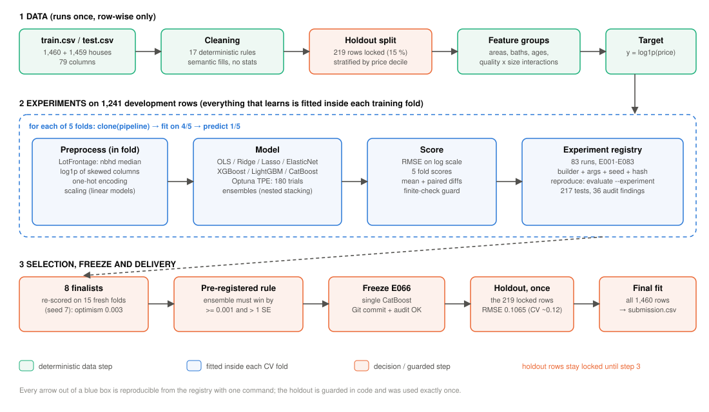
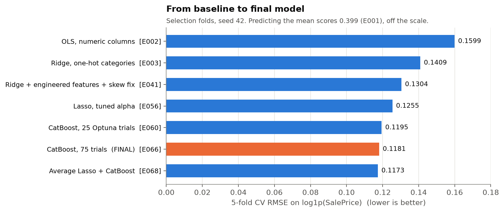
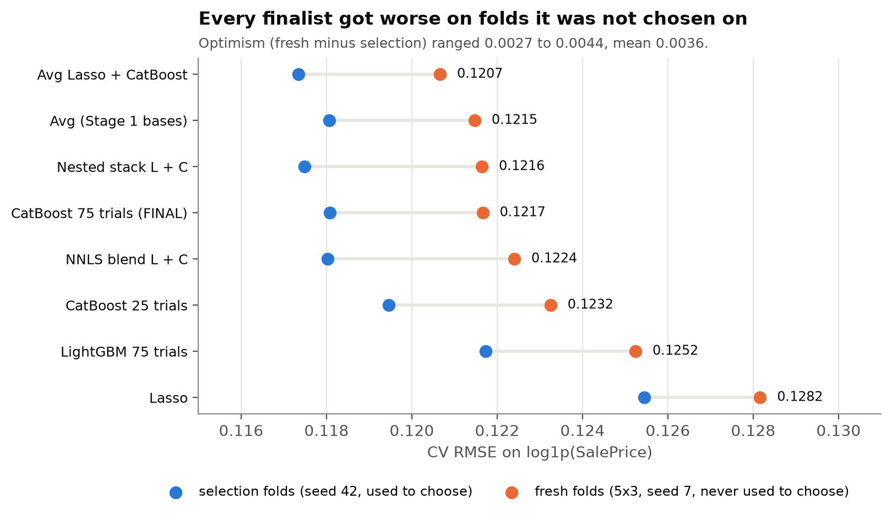

# House Prices (Kaggle, Ames) — a reproducible, audited ML research project

[](https://github.com/baenaee/house-prices-ml-pipeline/actions/workflows/tests.yml)


-0.1217-success)
-20BEFF)


**Portfolio documents:** [Technical report (PDF)](portfolio/HousePrices_Technical_Report.pdf) · [Slides (PDF)](portfolio/HousePrices_Slides.pdf) · [Model card](docs/MODEL_CARD.md) · [Executive summary](docs/EXECUTIVE_SUMMARY.md)

> **Status (2026-11-17):** complete. Final model frozen (single CatBoost, registry id E066), holdout scored once, submission file written, validated and submitted once: **Kaggle RMSLE 0.12271** on the full test set (rank 1,225 of 4,717, top 26 %, on 2026-11-26). See `docs/EXECUTIVE_SUMMARY.md` for the one-page version and `docs/RESEARCH_REPORT.md` for the full account.

This repository turns a careful exploratory notebook (78 cells of cleaning and EDA, 17 documented cleaning rules) into a complete, leakage-safe modelling project for the Kaggle competition *House Prices: Advanced Regression Techniques*. It was designed and directed by Enrique Baena and implemented with Claude Code — a research director agent coordinating four specialist agents (feature research, modelling, ensembles, validation audit) under the author's methodological rules and review — with every experiment logged, every methodological decision recorded with its evidence, and an independent auditor reading all pipeline code.

The original notebook and PDFs stay untouched at the repository root (hashes in `docs/AUDIT_2026-11-11.md`). The Kaggle data files are **not** in the repository, because the competition rules forbid redistributing them; see *Data* below. All new work lives in `src/`, `tests/`, `notebooks/`, `experiments/`, `docs/`.



## Results at a glance

Metric: RMSE on `log1p(SalePrice)` (identical to the competition's RMSLE). Model-selection protocol: shuffled 5-fold CV (seed 42) on the 1,241 development rows; the 219-row holdout (15 %, stratified by price decile) is scored exactly once after the procedure is frozen.

| stage | model | 5-fold CV RMSE (selection folds) | registry id |
|---|---|---|---|
| baseline | predict the mean of log-price | 0.3987 | E001 |
| baseline | OLS on numeric columns | 0.1599 | E002 |
| baseline | Ridge, one-hot, alpha 10 | 0.1409 | E003 |
| features | Ridge on engineered set + in-fold skew correction | 0.1304 | E041 |
| linear grid | Lasso (alpha 5.6e-4) | 0.1255 | E056 |
| boosting, Optuna stage 1 | CatBoost (25 trials) | 0.1195 | E060 |
| boosting, Optuna stage 2 | CatBoost (75 trials) | 0.1181 | E066 |
| ensemble | equal-weight average Lasso + CatBoost | 0.1173 | E068 |

**Final model: single CatBoost E066.**

<p align="center"> </p>

| estimate | RMSE | source |
|---|---|---|
| cross-validation on folds not used for tuning or for generating candidates, used once under a pre-registered rule to choose among eight finalists (RepeatedKFold 5x3, seed 7) | **0.1217** | E076 |
| the same for the Lasso + CatBoost average (not chosen: 0.0010 better, one third of a standard error) | 0.1207 | E077 |
| single-use holdout, 219 houses, scored once after the freeze (95 % bootstrap interval 0.092–0.121) | **0.1065** | `experiments/holdout_usage.log` |
| Kaggle test set, all 1,459 houses, one submission of the frozen model (recorded afterwards, used for no decision) | **0.1227** | Kaggle leaderboard, rank 1,225 of 4,717 (2026-11-26) |

Expected error on new houses: about 0.12. The holdout is a consistency check that came out on the favourable side (it contains none of the four hardest houses); it is not the headline. Submission file: `outputs/submissions/E066_all.csv`, submitted once; Kaggle's score on the whole test set, 0.1227, matches the cross-validated estimate. A public [Kaggle notebook](portfolio/kaggle/house-prices-leakage-safe-pipeline.ipynb) rebuilds the model from this repository and reproduces the same score.

Selection-fold scores are optimistic (0.002–0.003 measured by the auditor on linear grids, `docs/VALIDATION_AUDIT.md` §7; 0.003–0.004 for the eight finalists); finalists are therefore re-scored on folds they were not selected on, and differences below 0.003 are not treated as wins.

## What makes this project defensible

- **No preprocessing is ever fit outside a training fold.** Imputation (including the neighbourhood-median LotFrontage fill), skew correction (column selection is learned per fold), encoding and scaling all live inside a scikit-learn `Pipeline` that cross-validation refits on each fold.
- **Outlier removal is evaluated honestly.** Training-row filters are applied after the split and only to the training side; validation folds always keep every house. Under that protocol, dropping the two famous Ames outliers made every model *worse* (E049–E054), so the final model keeps all rows.
- **Stacking is nested.** Base models and the meta-learner are fit inside each outer training partition (inner out-of-fold predictions), so the meta-learner is never scored on rows it was fit on.
- **The holdout is single-use and guarded in code.** `validation.score_holdout_once` logs each use, refuses a second one, and refuses any frame that is not the registered holdout. `train.py` refuses to fit on all rows until the holdout has been scored.
- **Every experiment is reproducible from the registry.** `python -m houseprices.evaluate --experiment E056` rebuilds the pipeline from the stored builder and arguments and re-runs the seeded folds; it is the only accepted evidence for a reported score.
- **An independent auditor read everything.** Seven audit rounds plus a final round, 36 findings (F1–F36), each with severity, evidence and status, in `docs/VALIDATION_AUDIT.md`. Several were real bugs in the director's code (e.g. the identifier column was dropped before the outlier filter needed it, F9).

## Repository layout

```
HousePricing.ipynb, *.pdf                                    <- untouched originals
train.csv, test.csv, sample_submission.csv, data_description.txt   <- Kaggle data: downloaded, not committed
scripts/download_data.py   downloads the Kaggle data and verifies the SHA-256 of each file
src/houseprices/
  config.py       paths, seeds, CV spec, column groups, dictionary-vs-data spellings
  cleaning.py     the 17 cleaning rules as pure functions (+ reconstructed rule C01, anomaly flags)
  features.py     feature groups: base, areas, baths, ages, quality_interactions, ordinal_quality, anomaly_flags
  preprocess.py   fold-safe transformers: GroupMedianImputer, SkewLog1pTransformer, KNNLotFrontageImputer, YearRangeClipper
  validation.py   log target, RMSE-log metric, seeded folds, training-row filters, single-use holdout guard, CV runner
  models.py       builders for mean/OLS/Ridge/Lasso/ElasticNet/XGBoost/LightGBM/CatBoost + Optuna spaces
  ensemble.py     BlendingRegressor (NNLS weights learned in fit), NestedStackingRegressor, diversity metrics
  registry.py     append-only JSONL experiment registry + summary CSV
  data.py         the single data entry point (clean -> holdout split -> features)
  evaluate.py     reproduce a registered experiment's CV from seeds
  train.py        fit a registered configuration, save artefact + metadata sidecar
  predict.py      write a validated Kaggle submission file (never submits)
experiments/      registry.jsonl, holdout_ids.json, holdout_usage.log, per-block runners (models/, tuning/, feature_ablation/, ensemble/, finalists/, interpretability/)
notebooks/        01_cleaning_repaired (the original cleaning, repaired and executed), 02_feature_engineering, 03_modeling, 04_ensembles, 05_interpretability (thin, call src/)
portfolio/        technical report and slides (PDF), figures/, build/ (scripts that regenerate them)
.github/          CI workflow: runs the test suite on every push
outputs/          submissions/E066_all.csv, figures/ and interpretability/ (error analysis, permutation importance, SHAP); models/ is git-ignored
tests/            200+ tests: cleaning counts, features, preprocessing, validation protocol, models, ensembles, audit probes, end-to-end
docs/             TASK_BOARD, EXPERIMENT_HISTORY (decisions D1–D22), VALIDATION_AUDIT, RESEARCH_REPORT, STUDY_GUIDE, CHATGPT_AUDIT_PACKET, EXECUTIVE_SUMMARY, SESSION_CHECKPOINT
```

## Data

The data come from the Kaggle competition [House Prices: Advanced Regression Techniques](https://www.kaggle.com/competitions/house-prices-advanced-regression-techniques). Its rules allow academic, non-commercial use but forbid redistributing the files, so they are not in this repository. To get them: accept the competition rules on Kaggle, create an API token at kaggle.com/settings/api and give it to the Kaggle CLI (environment variable `KAGGLE_API_TOKEN`, or `kaggle auth login`), then run `pip install kaggle` and `python scripts/download_data.py`. The script puts the four files in the repository root and checks that each is byte-identical (SHA-256) to the copy every experiment was run on.

Two derived files that contain training target values (`outputs/interpretability/E066_oof_predictions.csv`, `experiments/finalists/holdout_predictions_E066.csv`) are also kept out of the repository; the first is regenerated by the interpretability runner, and the test that reads the second skips when it is absent.

## Setup

```powershell
conda env create -f environment.yml          # or: conda create -n houseprices python=3.12 && pip install -r requirements.txt
conda activate houseprices
pip install -e .
pip install kaggle; python scripts/download_data.py   # the Kaggle data (see Data above)
python -m pytest tests                        # pyproject already passes -q
```

Pinned: Python 3.12, pandas 2.3.3 (matches the original notebook), scikit-learn 1.9.1, xgboost 3.4.1, lightgbm 4.7.0, catboost 1.2.10, optuna 5.0.0.

## Commands

| purpose | command |
|---|---|
| reproduce a registered CV score | `python -m houseprices.evaluate --experiment E066` |
| reproduce the fresh-fold finalist score | `python -m houseprices.evaluate --experiment E076` |
| error analysis, permutation importance, SHAP | `python experiments/interpretability/run_interpretability.py --experiment E066` |
| run a block of experiments | `python experiments/models/run_baselines.py`, `experiments/feature_ablation/run_ablation.py`, `experiments/models/run_outlier_policy.py`, `experiments/models/run_linear_family.py`, `experiments/tuning/run_optuna_stage1.py`, `experiments/ensemble/run_ensembles.py`, `experiments/finalists/run_finalists.py` |
| fit the chosen configuration | `python -m houseprices.train --experiment <id>` (development rows) / `--rows all` (only after the holdout is scored) |
| write the submission file | `python -m houseprices.predict --model outputs/models/<id>_all.joblib` |

`train.py`/`predict.py` produce artefacts and a submission; they are not evidence of CV performance. The submission is written for manual upload; this project never calls the Kaggle API.

## Documentation

- `docs/EXECUTIVE_SUMMARY.md` — one page for a hiring manager.
- `docs/MODEL_CARD.md` — intended use, metrics, performance by segment, limitations.
- `portfolio/HousePrices_Technical_Report.pdf` and `portfolio/HousePrices_Slides.pdf` — the report as a paper-style PDF with figures, and a 13-slide deck. Rebuild with `python portfolio/build/make_figures.py` then `python portfolio/build/build_documents.py report slides` (needs Chrome or Edge).
- `docs/RESEARCH_REPORT.md` — hypotheses, experiments, results, decisions, limitations.
- `docs/STUDY_GUIDE.md` — the educational guide: maths, algorithms, hyper-parameters, feature engineering, validation, implementation, findings, rejected approaches, self-check questions.
- `docs/EXPERIMENT_HISTORY.md` — chronological log of every block with the director's rulings (D1–D22) and the evidence behind each.
- `docs/VALIDATION_AUDIT.md` — the independent auditor's findings and sign-offs.
- `docs/CHATGPT_AUDIT_PACKET.md` — claims to verify, with the commands that verify them, for an external reviewer.

## Known limitations

- The final choice is within noise: the Lasso + CatBoost average is 0.0010 better than the frozen single CatBoost on fresh folds, one third of a standard error; the simpler model was kept by a rule written before the comparison was read.
- Scores selected on the same folds are optimistic by roughly 0.003–0.004; the finalist check corrects the reported number, and the 219-row holdout (sampling error about 0.01) cannot rank close models.
- Errors concentrate in a few atypical houses and at the price extremes (15 of 1,241 houses carry 31 % of the squared error); both Stage 2 optima sit on the upper bound of the tree-count search range.
- The anomaly flags are constant in the training data (the anomalies exist only in test rows), so no model can learn them; the test-only `GarageYrBlt = 2207` is handled by an opt-in fold-safe clip (`clip_years`), and test Id 2550 resembles the two training outliers, so its prediction is checked by hand.
- The experiment registry is an append-only text file without locking; a single writer at a time is enforced by process, not by code (audit F27).
- Model artefacts are joblib pickles: load only files you produced (audit F28).

## Authorship and licence

The exploratory analysis and the 17 cleaning rules (`HousePricing.ipynb`, cleaning log) are the author's original work. The modelling campaign was planned with, and implemented by, Claude Code agent teams under the author's binding methodological rules (leakage boundaries, nested stacking, single-use holdout, honest outlier evaluation); the author reviewed and corrected the plan and made the final decisions. Code and documentation are released under the MIT licence (`LICENSE`); the Kaggle data are not redistributed here and remain under the competition's terms. The Git history was rewritten on 2026-11-25 to remove the data files; commit hashes cited in the documents refer to the rewritten history.
